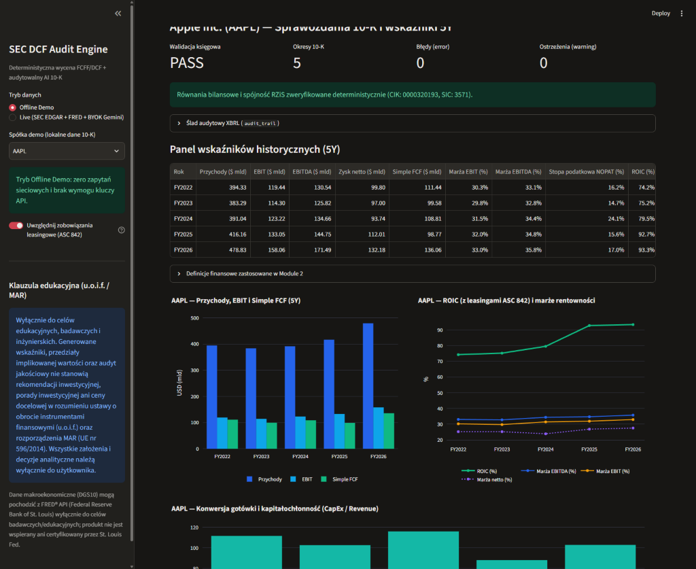
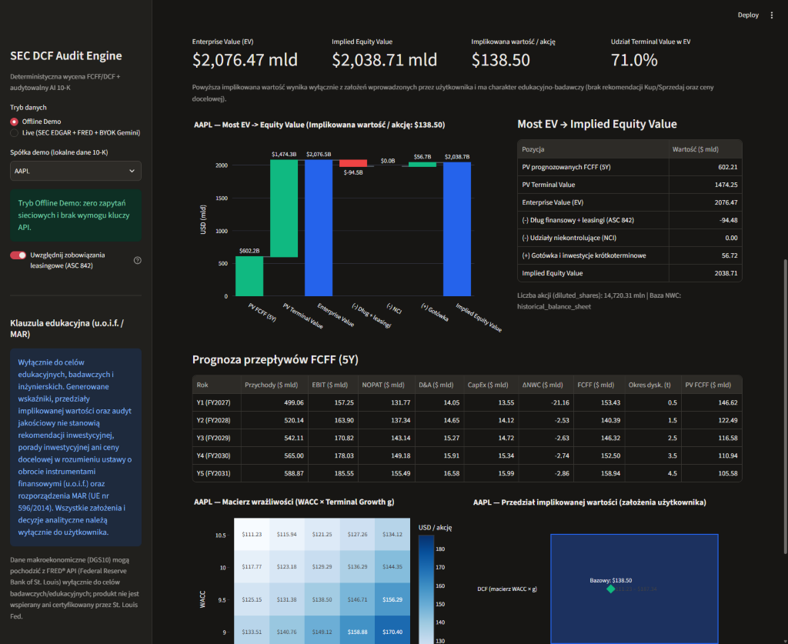
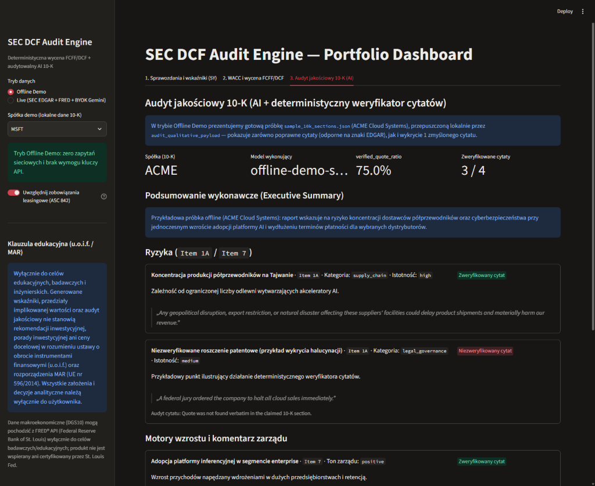

# SEC DCF Audit Engine — Moduły 1–4

Deterministyczny silnik pobierania, normalizacji XBRL, audytu księgowego (`10-K` / `10-K/A`), analizy wskaźnikowej, wyznaczania WACC, 5-letniej wyceny FCFF/DCF oraz audytowalnej analizy jakościowej raportów `10-K` (`Item 1A` i `Item 7`) dla spółek niefinansowych.

---

## 1. Architektura Modułu 1: Pobieranie i Walidacja 10-K

Moduł 1 (`sec_dcf.ingestion`, `sec_dcf.validation`) stanowi deterministyczną warstwę danych wejściowych pod model wyceny:

- **100% deterministyki w Pythonie (`Decimal`)**: wszystkie kwoty finansowe (w pełnych USD) i wskaźniki są przetwarzane bez użycia arytmetyki zmiennoprzecinkowej i bez udziału modeli LLM.
- **Źródło danych**: biblioteka `edgartools` (`Company` / `EntityFacts`) z wymaganym identyfikatorem `EDGAR_IDENTITY` oraz wbudowanym ogranicznikiem zapytań (`<= 8 req/s`, poniżej limitu SEC 10 req/s).
- **Zakres podmiotowy**: wyłącznie spółki operacyjne niefinansowe — instytucje finansowe (`company.is_financial_institution()` oraz kody **SIC 6000–6999**) są blokowane wyjątkiem `UnsupportedCompanyTypeError`.
- **Mapowanie XBRL i pełny ślad audytowy (`audit_trail`)**:
  - 5 ostatnich lat obrotowych (`10-K` / `10-K/A`) z deduplikacją okresów po najnowszej dacie złożenia (`filing_date`) i ignorowaniem raportów kwartalnych (`10-Q`).
  - Kanoniczne modele Pydantic v2 (`AnnualFinancialPeriod`, `CompanyFinancialsReport`) zawierające m.in.: `revenue`, `ebit`, `da`, `net_income`, `cash_and_equivalents`, `short_term_investments`, `short_term_debt`, `long_term_debt`, `current_lease_liabilities`, `noncurrent_lease_liabilities`, `total_liabilities`, `stockholders_equity`, `cfo`, `capex` (znormalizowany do wartości `>= 0`), `diluted_shares` (`duration`), `ending_shares` (`instant`) oraz pola wyliczane (`total_cash`, `financial_debt`, `lease_liabilities`, `total_debt_incl_leases`, `non_cash_nwc`, `fcf_simple`).
  - Każda zmapowana pozycja posiada obiekt `LineItemAudit` (`concept`, `raw_value`, `source_kind`, `period_end`, `filing_date`, `accession`, `note`).
- **Automatyczna walidacja księgowa (`validate_financials`)**:
  - Nietautologiczny test równania bilansowego (tolerancja `max($1M, 0.1% * Total Assets)`),
  - Test spójności RZiS (`pretax_income - tax_expense ≈ net_income`),
  - Kontrola unikalności i ciągłości okresów, znaków pozycji oraz relacji strukturalnych.

---

## 2. Architektura Modułu 2: Wskaźniki, WACC i Wycena FCFF/DCF

Moduł 2 (`sec_dcf.analysis`, `sec_dcf.models.analysis`) operuje wyłącznie na zwalidowanych modelach Pydantic (`Decimal`) z Modułu 1:

- **`ratios.py` (`compute_historical_metrics`)**:
  - Marże (`ebit_margin`, `ebitda_margin`, `net_margin`), bezpieczna stopa podatkowa do NOPAT (ograniczona do `[0%, 50%]`, z fallbackiem `21%` przy stracie przed opodatkowaniem lub braku danych), `invested_capital` (z i bez leasingów), `ROIC` na bazie średniego kapitału zainwestowanego (`None` dla `IC <= 0`), konwersja gotówki (`fcf_simple / net_income`, `None` przy stracie netto), kapitałochłonność (`capex_to_revenue`, `da_to_revenue`, `non_cash_nwc_to_revenue`), `Net Debt` (bez i z leasingami), `Net Debt / EBITDA` (dopuszczające ujemne wartości przy pozycji gotówki netto, `None` przy `EBITDA <= 0`) oraz `interest_coverage`.
- **`fred_client.py` (`FredClient`, `fetch_risk_free_rate`)**:
  - Lekki klient darmowego FRED API (oparty o standardową bibliotekę `urllib.request` z jawnym timeoutem `10s`) pobierający najnowszą ważną obserwację serii `DGS10` (rentowność 10-letnich obligacji skarbowych USA), z pomijaniem braków danych (`"."`) oraz maskowaniem klucza `FRED_API_KEY` w komunikatach wyjątków `FredApiError`.
- **`wacc.py` (`calculate_wacc`)**:
  - Koszt kapitału własnego w modelu CAPM (`Rf + beta * ERP`) z możliwością podania ręcznego `risk_free_rate` (tryb w 100% offline), wagi rynkowe kapitału (`market_cap_override` lub `share_price * shares`, opcjonalny `allow_book_equity_fallback`) oraz koszt długu przed i po podatku (z kontrolą wiarygodności `[Rf, 25%]` i fallbackiem `Rf + default_credit_spread`).
- **`dcf.py` (`suggest_dcf_assumptions`, `run_dcf_valuation`, `build_sensitivity_matrix`)**:
  - Model 5-letnich założeń projekcji (`DcfAssumptions`, obsługujący stałe wartości `Decimal` lub 5-elementowe ścieżki rok-po-roku) wraz z funkcją wyznaczającą punkt startowy z median historycznych.
  - Projekcja $FCFF_t = EBIT_t \cdot (1 - t) + D\&A_t - CapEx_t - \Delta NWC_t$ z obsługą dyskontowania `end_of_year` oraz `mid_year` ($t - 0.5$ dla $FCFF_t$ oraz $5.0$ dla wartości rezydualnej).
  - Wartość rezydualna metodą Gordona (twardy wyjątek domenowy `DcfValuationError`, gdy $WACC \le g$, oraz ostrzeżenie przy $FCFF_5 \le 0$), opcjonalny cross-check mnożnikiem wyjścia `EV/EBITDA`, most `Enterprise Value -> Equity Value -> Implied Value per Share` oraz dwuwymiarowa macierz wrażliwości `WACC × terminal_growth_rate`.
- **Spójna obsługa leasingów ASC 842 (`include_leases: bool`)**:
  - Flaga `include_leases` musi być spójna między `WaccResult` a `DcfAssumptions` (niezgodność zgłasza `DcfValuationError`).
  - Przy `include_leases=True` zobowiązania leasingowe są włączane konsekwentnie do `Invested Capital`, wag długu w WACC oraz odjęć w moście `EV -> Equity Value`. Zgodnie z US GAAP (ASC 842) koszt leasingu operacyjnego nie trafia do `interest_expense`, dlatego implikowany koszt długu `Kd` (bez override'u) wyliczany jest zawsze od oprocentowanego `financial_debt`, a `EBIT`/`EBITDA` nie są korygowane o implikowane odsetki leasingowe.

---

## 3. Architektura Modułu 3: Audytowalna Analiza Jakościowa 10-K (`google-genai`)

Moduł 3 (`sec_dcf.qualitative`, `sec_dcf.models.qualitative`) łączy ekstrakcję sekcji opisowych `10-K` z warstwą AI opartą wyłącznie o aktualne SDK **`google-genai`** (`from google import genai`) oraz deterministycznym audytem w Pythonie:

- **`extractor.py` (`TenKTextExtractor`, `build_sections_from_texts`)**:
  - Pobieranie najnowszego raportu `10-K` przez `edgartools` ze współdzielonym ogranicznikiem zapytań (`<= 8 req/s`) oraz blokadą instytucji finansowych (**SIC 6000–6999**).
  - Ekstrakcja **Item 1A (Risk Factors)** oraz **Item 7 (MD&A)** (z bezpiecznym fallbackiem indeksowania `tenk["Item 1A"]` / `tenk["Item 7"]`) oraz konfigurowalnym przycinaniem promptu (`max_chars_per_section = 60_000`), przy jednoczesnym zachowaniu pełnego `raw_text` do weryfikacji cytatów.
  - Funkcja `build_sections_from_texts` umożliwia analizę w 100% offline na lokalnych tekstach.
- **`gemini_client.py` (`GeminiQualitativeAnalyzer`)**:
  - Tryb **BYOK** (klucz czytany z `GEMINI_API_KEY` w `.env`, maskowany w komunikatach wyjątków `GeminiApiError`, nigdy nie zapisywany w kodzie).
  - Konfigurowalny model (domyślnie `gemini-3.8-flash`, z możliwością przełączenia np. na `gemini-4-hydrogen`), jawny timeout HTTP (`types.HttpOptions(timeout=...)` w milisekundach) oraz `response_schema=QualitativeExtractionPayload` (Pydantic Structured Outputs) przy `temperature=0.0`.
  - Twarde instrukcje systemowe zakazujące obliczeń finansowych, cen docelowych i rekomendacji „Kup/Sprzedaj” oraz wymuszające `verbatim_quote` + `section` dla każdego punktu.
- **`verifier.py` (`audit_qualitative_payload`, `verify_quote_in_section`, `normalize_for_quote_match`)**:
  - Deterministyczna weryfikacja każdego `verbatim_quote` wobec oryginalnego tekstu wskazanej sekcji (usuwanie znaków zerowej szerokości `\u200b`/`\ufeff`/`\u00ad`, zamiana `\xa0`/`\u202f` na spację, ujednolicenie typografii i kolaps białych znaków) wraz z wykrywaniem pomyłek między sekcjami (`Item 1A` vs `Item 7`).
  - Wyliczanie `verified_quote_ratio` (`Decimal`), ostrzeżenie `NO_CLAIMS_EXTRACTED` przy 0 punktach oraz skaner zgodności (`scan_prohibited_advice`) sprawdzający pola generowane przez AI (z pominięciem `verbatim_quote`). Tryb `strict=True` rzuca `QualitativeAuditError` przy niezweryfikowanych cytatach, 0 punktach lub flagach zgodności.

---

## 4. Architektura Modułu 4: Dashboard Streamlit + Plotly (`app/streamlit_app.py`)

Moduł 4 udostępnia interaktywną warstwę wizualną w Streamlit + Plotly (`src/sec_dcf/ui/`, `app/streamlit_app.py`), bez duplikowania jakiejkolwiek matematyki finansowej:

- **Tryb Offline Demo (domyślny):** uruchamia się natychmiast bez kluczy API i bez połączeń sieciowych, wykorzystując lokalne próbki `AAPL`, `MSFT` i **`AMZN`** (`tests/fixtures/`) oraz próbkę audytu jakościowego (`sample_10k_sections.json`).
- **Tryb Live (SEC EDGAR + FRED + BYOK Gemini):** pozwala wpisać dowolny ticker spółki niefinansowej, pobrać aktualne `DGS10` z FRED oraz uruchomić audyt 10-K na własnym kluczu `GEMINI_API_KEY` wpisywanym w polu `password` (przechowywanym wyłącznie w `st.session_state`, nigdy niezapisywanym na dysk ani w `st.cache_data`).
- **Trzy zakładki + stały pasek boczny (u.o.i.f. / MAR):**
  1. **Sprawozdania i wskaźniki (5Y):** status walidacji księgowej (`is_valid`, `validation_issues`, inspektor `audit_trail`), tabela 5Y (w tym `SBC`, `True FCF ex-SBC`, `SBC / Przychody`, `SBC / CFO`) i wykresy Plotly (Przychody/EBIT/FCF, ROIC i marże, Konwersja gotówki i CapEx/Revenue).
  2. **WACC i wycena FCFF/DCF:** spójny przełącznik `include_leases` (ASC 842), `mid_year` vs `end_of_year`, jawny przełącznik `add_back_sbc` (koszt ekonomiczny w GAAP EBIT vs wariant CFO), edycja skalarna lub pełne ścieżki 5-letnie (`st.data_editor`), most `EV → Equity Value → Implied Value per Share`, konfrontacja bieżących mnożników rynkowych z mnożnikami implikowanymi z DCF (`EV/Revenue`, `EV/EBITDA`, `EV/EBIT`, `P/E`, `Reported FCF Yield`, `True FCF Yield ex-SBC`), mapa ciepła wrażliwości `WACC × g`, wykres przedziału wartości (*football field*) oraz **eksport audytowalnego pliku Excel `.xlsx` z żywymi formułami (`openpyxl`)**.
  3. **Audyt jakościowy 10-K (AI):** wybór modelu (`gemini-3.8-flash`, `gemini-3.5-flash-lite`, `gemini-4-hydrogen`) z opcjonalnym automatycznym fallbackiem na `gemini-3.5-flash-lite` przy błędzie `503 UNAVAILABLE`, wskaźnik `verified_quote_ratio`, ostrzeżenie o przycięciu sekcji, detekcja pozabilansowych zobowiązań leasingowych (`leases not yet commenced`) w `red_flags` i karty z odznakami `quote_verified`.

Szczegółowe definicje księgowe, obsługę ASC 842, traktowanie SBC (EBIT vs CFO), hierarchię tagów XBRL oraz znane ograniczenia opisuje plik [ASSUMPTIONS.md](ASSUMPTIONS.md).

```powershell
# Instalacja zależności dashboardu i uruchomienie aplikacji
pip install -e ".[app]"
streamlit run app/streamlit_app.py
```

### Podgląd interfejsu (tryb Offline Demo)

**1. Sprawozdania i wskaźniki (5Y) — walidacja bilansowa XBRL i panel wskaźników:**



**2. WACC i wycena FCFF/DCF — most EV → Equity, prognozy 5Y, wrażliwość i *football field*:**



**3. Audyt jakościowy 10-K (AI) — weryfikacja cytatów `Item 1A` / `Item 7` i odznaki `quote_verified`:**



---

## 5. Przykład użycia w Pythonie

```python
from decimal import Decimal
from sec_dcf import (
    WaccInputs,
    build_sensitivity_matrix,
    calculate_wacc,
    compute_historical_metrics,
    fetch_company_financials,
    run_dcf_valuation,
    suggest_dcf_assumptions,
)

# 1. Pobranie i walidacja 5 lat 10-K z SEC EDGAR (wymaga EDGAR_IDENTITY w .env)
report = fetch_company_financials("MSFT", years=5, strict=True)

# 2. Panel wskaźników historycznych (spójnie z flagą include_leases)
metrics = compute_historical_metrics(report, include_leases=True)

# 3. Wyliczenie WACC (risk_free_rate=None pobiera DGS10 z FRED_API_KEY; można też podać ręcznie)
wacc_result = calculate_wacc(
    report,
    WaccInputs(
        risk_free_rate=Decimal("0.0425"),  # lub None -> FRED DGS10
        beta=Decimal("1.10"),
        equity_risk_premium=Decimal("0.045"),
        share_price=Decimal("450"),
        include_leases=True,
    ),
)

# 4. Sugestia założeń z historii + 5-letnia wycena FCFF/DCF (mid_year)
assumptions = suggest_dcf_assumptions(
    report,
    include_leases=True,
    discounting_convention="mid_year",
)
dcf_result = run_dcf_valuation(report, assumptions, wacc_result)

# 5. Dwuwymiarowa macierz wrażliwości WACC x terminal_growth_rate
sensitivity = build_sensitivity_matrix(
    report,
    assumptions,
    wacc_values=[
        wacc_result.wacc - Decimal("0.005"),
        wacc_result.wacc,
        wacc_result.wacc + Decimal("0.005"),
    ],
    terminal_growth_values=[Decimal("0.020"), Decimal("0.025"), Decimal("0.030")],
    base_wacc=wacc_result,
)

print("WACC:", wacc_result.wacc)
print("Implied Value/Share:", dcf_result.bridge.implied_value_per_share)
print("Range:", sensitivity.min_implied_value_per_share, "-", sensitivity.max_implied_value_per_share)
```

---

## 6. Instalacja i uruchomienie testów (100% offline)

Projekt wymaga **Pythona 3.11+**.

```powershell
# 1. Utworzenie i aktywacja środowiska wirtualnego (Windows PowerShell)
python -m venv .venv
.\.venv\Scripts\Activate.ps1

# 2. Instalacja paczki wraz z zależnościami deweloperskimi i dashboardu
pip install -e ".[dev,app]"

# 3. Uruchomienie pełnego zestawu testów (100% offline)
pytest -v
```

> Wszystkie testy `pytest` (Moduły 1–4, eksport `.xlsx`, mnożniki rynkowe, testy logiki UI i `AppTest` dla dashboardu) działają w **100% offline** — korzystają z lokalnych próbek w `tests/fixtures/` (`aapl_companyfacts.json`, `msft_companyfacts.json`, `amzn_companyfacts.json`, `sample_10k_sections.json`) oraz mockowanych transportów, blokując jakiekolwiek wywołania sieciowe do SEC EDGAR, FRED API oraz Gemini API. Konfiguracja `pythonpath = ["src"]` w `pyproject.toml` umożliwia uruchamianie `.\.venv\Scripts\python.exe -m pytest -v` również bezpośrednio bez wcześniejszej instalacji edytowalnej.

---

## 7. Konfiguracja `.env` i atrybucja danych FRED

Przed wywołaniem zapytań sieciowych do SEC EDGAR, FRED API lub Gemini API utwórz plik `.env` na bazie szablonu `.env.example` i uzupełnij wymagane zmienne:

```dotenv
EDGAR_IDENTITY="TwojaNazwaAplikacji kontakt@twojadomena.com"
FRED_API_KEY=twoj_klucz_fred_api
GEMINI_API_KEY=twoj_klucz_gemini_api
```

- `EDGAR_IDENTITY` jest wymagane przez SEC EDGAR przy wywołaniach `fetch_company_financials` oraz `TenKTextExtractor`.
- `FRED_API_KEY` (darmowy klucz z serwisu FRED) jest wymagany przez `FredClient` przy pobieraniu bieżącej stopy `DGS10`. W trybie offline lub w testach można przekazać `risk_free_rate` ręcznie w `WaccInputs`.
- `GEMINI_API_KEY` (tryb BYOK) jest wymagany przez `GeminiQualitativeAnalyzer` przy analizie online z użyciem modeli Gemini (`google-genai`). W testach offline można wstrzyknąć mockowanego klienta przez parametr `client=...`.
- Plik `.env` jest ignorowany przez Git i nie powinien być nigdy commitowany do repozytorium.

**Atrybucja danych FRED:** Produkt korzysta z FRED® API (Federal Reserve Bank of St. Louis) wyłącznie w celach badawczych i edukacyjnych, ale nie jest wspierany ani certyfikowany przez Federal Reserve Bank of St. Louis. Korzystanie z danych FRED podlega warunkom [FRED® API Terms of Use](https://fred.stlouisfed.org/docs/api/terms_of_use.html).

---

## 8. Klauzula edukacyjna i brak doradztwa inwestycyjnego

**PL:** Projekt ma charakter wyłącznie edukacyjny, badawczy i inżynierski. Narzędzie oraz generowane przez nie dane i przedziały wartości nie stanowią rekomendacji inwestycyjnej, porady inwestycyjnej ani analizy inwestycyjnej w rozumieniu ustawy o obrocie instrumentami finansowymi (u.o.i.f.) oraz rozporządzenia MAR (UE nr 596/2014). Wszelkie założenia i decyzje analityczne należą wyłącznie do użytkownika.

**EN:** This project is strictly for educational, research, and engineering purposes only. Neither the software nor any outputs or implied valuation ranges produced by it constitute investment advice, a financial promotion, or an investment recommendation within the meaning of the Polish Act on Trading in Financial Instruments (u.o.i.f.) or Regulation (EU) No 596/2014 (MAR). All assumptions and analytical decisions remain solely the responsibility of the user.
